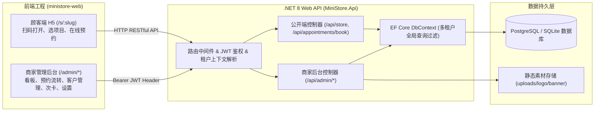

# MiniStore 小店数字化系统开发计划（.NET 8 + Vue 3 前后端分离版）

> **MVP 核心纲领**：低成本上线、扫码即用、多租户复用、验证闲鱼真实付费需求。后端采用 **ASP.NET Core 8 Web API**，前端采用 **Vue 3 + TypeScript + Vite**，实现前后端分离架构，跑通“顾客扫码 → 选项目 → 在线预约 → 商家后台处理”完整闭环。

---

## 1. 架构调整与系统拓扑

### 1.1 核心技术栈
- **后端**：ASP.NET Core 8.0 Web API、Entity Framework Core（EF Core 全局租户查询过滤）、JWT Bearer 认证、Swagger / OpenAPI、本地/对象文件存储。
- **前端**：Vue 3 + TypeScript + Vite + Pinia + Vue Router + Element Plus / 移动端组件库。
- **数据库**：EF Core Code First，支持 SQLite（零配置即起）与 PostgreSQL 灵活切换。
- **部署模式**：
  - 前端静态构建输出，可托管于 Cloudflare Pages / Nginx / 宝塔。
  - 后端作为跨平台服务运行，提供 RESTful JSON 接口。

### 1.2 架构拓扑

---

## 2. 任务分解结构（WBS：T01 ~ T13）

| 任务编号 | 模块 | 交付物 | 技术要点与验收标准 |
| :--- | :--- | :--- | :--- |
| **T01** | .NET 8 骨架与基建 | `MiniStore.Api` 项目、`MiniStore.sln` | 依赖注入、统一异常处理、CORS 跨域配置、Swagger 调试通过 |
| **T02** | EF Core 实体与多租户隔离 | 10 张实体模型、`AppDbContext`、全局租户过滤器 | `TenantId` 自动注入与自动筛选，支持数据库一键迁移 |
| **T03** | 种子数据与演示租户 | `DbInitializer` 种子包（MUSE NAIL 美甲店） | 初始化包含美甲分类、服务、价格、拟真预约与次卡 |
| **T04** | 认证与租户中间件 | `AuthController`、JWT 服务、`TenantMiddleware` | 支持商家注册/登录，颁发 JWT，Header 解析 `tenant_id` |
| **T05** | 顾客端公开 API | `StoreController`、`BookingController` | 按 slug 查询公开店招与服务列表，提交预约与冲突排重 |
| **T06** | 商家端核心业务 API | Dashboard、预约流转、客户、次卡、设置 API | 状态流转（确认/核销/取消）、次卡扣减流水日志记录 |
| **T07** | 素材上传与静态文件 | `UploadController` 与静态文件托管中间件 | 支持 Logo、Banner 图片上传并生成外部访问 URL |
| **T08** | 前端工程搭建 | `ministore-web` (Vue 3 + TS + Vite + Pinia) | 封装 Axios 统一请求拦截器（自动附带 Bearer Token） |
| **T09** | 顾客端 H5 页面 | 门店主页、服务分类列表、预约表单与成功页 | 移动端良好适配，微信扫码友好，支持一键拨号与地址复制 |
| **T10** | 商家端后台视图 | 登录页、Dashboard 看板、预约管理、客户档案 | 实时数据交互，状态一键操作，次卡快捷扣减弹窗 |
| **T11** | 门店设置与动态二维码 | 资料配置页、高清立牌二维码生成组件 | 自动基于线上/本地地址生成二维码，支持下载打印 |
| **T12** | 前后端端到端联调 | 本地与内网穿透/局域网真机联调 | 真实手机扫码测试走通预约闭环与商家处理流程 |
| **T13** | 部署与闲鱼交付包装 | 编译产物脚本、交付 SOP、闲鱼展示图与视频 | 单店配置 30 分钟交付流程固化，验收清单 10 项全通 |

---

## 3. 多租户隔离机制（EF Core 实现）

在 .NET 8 中，采用 **EF Core 全局查询过滤器（Global Query Filters）** 代替原 Supabase RLS，兼具更高性能与强类型安全：
1. **自动过滤**：所有租户实体继承 `IMustHaveTenant` 接口（含 `Guid TenantId`）。
2. **上下文注入**：请求到达时，`TenantMiddleware` 从 JWT Token Claims 或 Header 中提取 `TenantId` 并注入 Scoped 作用域的 `ITenantContext`。
3. **全局防漏**：在 `AppDbContext.OnModelCreating` 中统一为所有租户实体配置 `.HasQueryFilter(e => e.TenantId == _tenantContext.CurrentTenantId)`，商家端任何查询绝不可能越权获取其他租户数据。
4. **公开端安全**：顾客端接口显式通过 `storeSlug` 查询指定门店，仅投射公开安全的 DTO（不泄露客户电话、内部流水等敏感信息）。

---

## 4. 执行路线
1. **构建后端**：初始化 `MiniStore.Api`，创建 10 个核心实体，配置 EF Core 与数据库迁移。
2. **种子数据**：灌入 MUSE NAIL 示范数据，编写控制器端点并配置 Swagger。
3. **构建前端**：初始化 `ministore-web`，构建顾客端 `/s/:slug` 与商家端 `/admin/*`。
4. **端到端跑通**：从手机扫码到后台完成预约全闭环。
